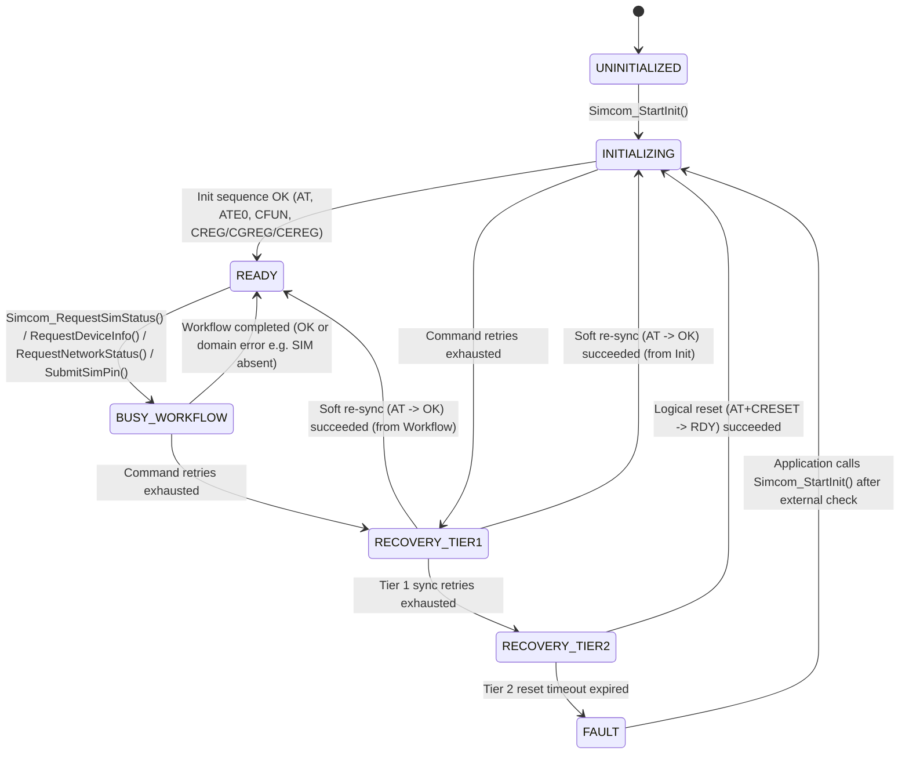

# Phase 1 Data Model: Basic Modem Initialization and Control (`001-basic-modem-control`)

**Date**: 2026-10-21  
**Spec**: `specs/001-basic-modem-control/spec.md`  
**Research**: `specs/001-basic-modem-control/research.md`

All data structures strictly adhere to Constitution Principle 1 (Zero Dynamic Memory Allocation) and Section 3 (ISO C11 fixed-width integer types `uint8_t`, `uint16_t`, `uint32_t`, `int16_t`, `int32_t`, `bool`, `size_t`). No heap allocations or VLAs are used anywhere in the data model.

---

## 1. Compile-Time & Runtime Configuration (`Library Configuration`)

### 1.1 Compile-Time Bounds (`inc/simcom_cfg.h`)

| Macro | Default | Validation Rule (`_Static_assert`) | Description |
| :--- | :--- | :--- | :--- |
| `SIMCOM_CFG_RX_BUF_SIZE` | `512U` | `>= 128U && <= 4096U` | SPSC RX ring buffer capacity in bytes (power of two recommended). |
| `SIMCOM_CFG_LINE_BUF_SIZE` | `256U` | `>= 64U && <= 1024U` | Line tokenization scratchpad capacity in bytes. |
| `SIMCOM_CFG_TX_CMD_BUF_SIZE` | `128U` | `>= 32U && <= 512U` | Active command transmit buffer capacity in bytes. |
| `SIMCOM_CFG_STR_MAX_LEN` | `32U` | `>= 24U && <= 64U` | Max length (including NUL terminator) for identity/operator strings. |
| `SIMCOM_CFG_ICCID_MAX_LEN` | `24U` | `>= 21U && <= 32U` | Max length (including NUL terminator) for 20-digit SIM ICCID. |
| `SIMCOM_CFG_IMEI_MAX_LEN` | `20U` | `>= 16U && <= 24U` | Max length (including NUL terminator) for 15-digit IMEI. |
| `SIMCOM_CFG_PIN_MAX_LEN` | `9U` | `== 9U` | Max length for 4–8 digit SIM PIN string plus NUL terminator. |

### 1.2 Runtime Operational Configuration (`simcom_runtime_cfg_t`)

| Field | Type | Default | Validation Rule | Description |
| :--- | :--- | :--- | :--- | :--- |
| `default_cmd_timeout_ms` | `uint32_t` | `1000U` | `>= 100U && <= 180000U` | Default command response timeout when not overridden by profile. |
| `net_query_timeout_ms` | `uint32_t` | `5000U` | `>= 500U && <= 180000U` | Timeout for slow carrier/registration queries (`AT+COPS?`, `AT+CREG?`). |
| `max_cmd_retries` | `uint8_t` | `2U` | `<= 10U` | Retries per idempotent command before escalating to Tier 1 recovery. |
| `tier1_sync_retries` | `uint8_t` | `3U` | `>= 1U && <= 10U` | Number of `AT\r\n` probe attempts in Tier 1 soft re-synchronization. |
| `tier2_reset_timeout_ms` | `uint32_t` | `10000U` | `>= 1000U && <= 60000U` | Max wait for `RDY` indication after Tier 2 logical reset (`AT+CRESET`). |
| `min_log_level` | `simcom_log_level_t` | `SIMCOM_LOG_LEVEL_INFO` | Valid enum value (`DEBUG`..`NONE`) | Minimum diagnostic log threshold forwarded to `log_fn`. |

---

## 2. I/O & Hardware Abstraction (`I/O Interface` & `Logging Interface`)

### 2.1 HAL Interface (`simcom_hal_if_t`)

| Field | Signature | Mandatory? | Description |
| :--- | :--- | :--- | :--- |
| `uart_tx_async` | `size_t (*)(const uint8_t *data, size_t len, void *user_ctx)` | **Yes** | Non-blocking transmit hook. Returns number of bytes accepted (`0..len`). |
| `get_tick_ms` | `uint32_t (*)(void *user_ctx)` | **Yes** | Monotonic millisecond tick counter (wrap-around safe via unsigned diff). |
| `enter_critical` | `void (*)(void *user_ctx)` | Optional (`NULL` ok) | Optional critical section entry hook (SPSC ring buffer is lock-free by default). |
| `exit_critical` | `void (*)(void *user_ctx)` | Optional (`NULL` ok) | Optional critical section exit hook. |
| `gpio_write_pwrkey` | `void (*)(bool asserted, void *user_ctx)` | Optional (`NULL` ok) | Reserved for Tier 3 hardware power key pulse (nullable in v1). |
| `gpio_write_reset` | `void (*)(bool asserted, void *user_ctx)` | Optional (`NULL` ok) | Reserved for Tier 3 hardware reset pin pulse (nullable in v1). |
| `gpio_read_status` | `bool (*)(void *user_ctx)` | Optional (`NULL` ok) | Reserved for hardware STATUS pin readback (nullable in v1). |
| `user_ctx` | `void *` | Optional (`NULL` ok) | Opaque caller context pointer passed back to all HAL and log callbacks. |

### 2.2 Logging Interface (`simcom_log_fn_t`)

- **Severity Enum (`simcom_log_level_t`)**:
  - `SIMCOM_LOG_LEVEL_DEBUG = 0` (Raw TX/RX byte frames, lexer tokens)
  - `SIMCOM_LOG_LEVEL_INFO = 1` (Workflow transitions, command completions, URC events)
  - `SIMCOM_LOG_LEVEL_WARNING = 2` (Command timeouts, retries, RX buffer overflow, Tier 1 recovery)
  - `SIMCOM_LOG_LEVEL_ERROR = 3` (Tier 2 reset escalation, terminal fault `MODEM_UNRESPONSIVE`, CME errors)
  - `SIMCOM_LOG_LEVEL_NONE = 4` (Logging disabled)
- **Direction / Category Enum (`simcom_log_dir_t`)**:
  - `SIMCOM_LOG_DIR_TX`, `SIMCOM_LOG_DIR_RX`, `SIMCOM_LOG_DIR_URC`, `SIMCOM_LOG_DIR_FSM`
- **Callback Signature (`simcom_log_fn_t`)**:
  `void (*simcom_log_fn_t)(simcom_log_level_t level, uint32_t timestamp_ms, simcom_log_dir_t dir, const uint8_t *payload, size_t len, void *user_ctx)`

---

## 3. Domain Entities

### 3.1 Device Information (`simcom_device_info_t`)

Populated via `Simcom_RequestDeviceInfo()` (`ATI`, `AT+CGMM`, `AT+CGMR`, `AT+CGSN`).

| Field | Type | Validation / Invariants | Description |
| :--- | :--- | :--- | :--- |
| `manufacturer` | `char[SIMCOM_CFG_STR_MAX_LEN]` | NUL-terminated ASCII string | Manufacturer string (e.g., `"INCORPORATED"` or `"SIMCOM_Ltd"`). |
| `model` | `char[SIMCOM_CFG_STR_MAX_LEN]` | NUL-terminated ASCII string | Modem model name (e.g., `"A7600C"`, `"A7670E"`). |
| `revision` | `char[SIMCOM_CFG_STR_MAX_LEN]` | NUL-terminated ASCII string | Firmware revision identifier (e.g., `"A7600C_V1.0"`). |
| `imei` | `char[SIMCOM_CFG_IMEI_MAX_LEN]` | 14–15 numeric digits (`'0'`–`'9'`), NUL-terminated | International Mobile Equipment Identity serial number. |
| `is_valid` | `bool` | `true` only when all fields queried and validated | Indicates cached device metadata is populated. |

### 3.2 SIM Card Profile (`simcom_sim_info_t`)

Populated via `Simcom_RequestSimStatus()` (`AT+CPIN?` and conditional `AT+CICCID`) and updated by `+CPIN:` URCs or `Simcom_SubmitSimPin()`.

- **SIM State Enum (`simcom_sim_state_t`)**:
  - `SIMCOM_SIM_STATE_UNKNOWN = 0`
  - `SIMCOM_SIM_STATE_READY = 1` (`+CPIN: READY`)
  - `SIMCOM_SIM_STATE_PIN_REQUIRED = 2` (`+CPIN: SIM PIN`)
  - `SIMCOM_SIM_STATE_PUK_REQUIRED = 3` (`+CPIN: SIM PUK` or `+CME ERROR: 12`)
  - `SIMCOM_SIM_STATE_ABSENT = 4` (`+CME ERROR: 10` SIM not inserted)
  - `SIMCOM_SIM_STATE_FAULTY = 5` (`+CPIN: SIM CRASH`, `+CME ERROR: 13` SIM failure, or `+CME ERROR: 15` SIM wrong)

| Field | Type | Validation / Invariants | Description |
| :--- | :--- | :--- | :--- |
| `state` | `simcom_sim_state_t` | Valid enum value | Current operational/lock state of the SIM card. |
| `iccid` | `char[SIMCOM_CFG_ICCID_MAX_LEN]` | 18–20 numeric/hex characters, NUL-terminated | Integrated Circuit Card Identifier (populated when `state == SIMCOM_SIM_STATE_READY`). |
| `last_cme_error` | `uint16_t` | `0` if no error, else 3GPP CME code | Last `+CME ERROR` code observed during SIM interrogation or PIN entry. |
| `is_iccid_valid` | `bool` | `true` only when `+ICCID:` parsed | Indicates whether `iccid` holds a verified card serial. |

### 3.3 Network Registration State (`simcom_net_status_t`)

Updated both asynchronously via `+CREG:` / `+CGREG:` / `+CEREG:` URCs and on demand via `Simcom_RequestNetworkStatus()`.

- **Registration State Enum (`simcom_reg_state_t`)**:
  - `SIMCOM_REG_NOT_REGISTERED = 0` (`<stat> = 0`: Not registered, not searching)
  - `SIMCOM_REG_HOME = 1` (`<stat> = 1`: Registered, home network)
  - `SIMCOM_REG_SEARCHING = 2` (`<stat> = 2`: Not registered, currently searching)
  - `SIMCOM_REG_DENIED = 3` (`<stat> = 3`: Registration denied)
  - `SIMCOM_REG_UNKNOWN = 4` (`<stat> = 4`: Unknown)
  - `SIMCOM_REG_ROAMING = 5` (`<stat> = 5`: Registered, roaming)
- **Radio Access Technology Enum (`simcom_act_t`)**:
  - `SIMCOM_ACT_UNKNOWN = 0`
  - `SIMCOM_ACT_GSM = 1` (`+COPS` AcT `0` or `+CPSI: GSM`)
  - `SIMCOM_ACT_UTRAN = 2` (`+COPS` AcT `2` or `+CPSI: WCDMA`)
  - `SIMCOM_ACT_LTE = 3` (`+COPS` AcT `7` or `+CPSI: LTE`)

| Field | Type | Validation / Invariants | Description |
| :--- | :--- | :--- | :--- |
| `cs_reg` | `simcom_reg_state_t` | Mapped from `+CREG` `<stat> 0..5` | Circuit-switched (GSM) registration status. |
| `ps_reg` | `simcom_reg_state_t` | Mapped from `+CGREG` `<stat> 0..5` | Packet-switched (GPRS) registration status. |
| `eps_reg` | `simcom_reg_state_t` | Mapped from `+CEREG` `<stat> 0..5` | EPS (LTE) registration status. |
| `rssi_raw` | `uint8_t` | `0..31` or `99` (unknown) | Raw 3GPP `<rssi>` indicator from `AT+CSQ`. |
| `rssi_dbm` | `int16_t` | `-113..-51` dBm, or `0` when `rssi_raw == 99` | Converted signal strength in dBm (`-113 + 2 * rssi_raw`). |
| `ber_raw` | `uint8_t` | `0..7` or `99` (unknown) | Raw 3GPP `<ber>` bit error rate indicator from `AT+CSQ`. |
| `act` | `simcom_act_t` | Valid enum value | Active Radio Access Technology (GSM, UTRAN, LTE). |
| `operator_name` | `char[SIMCOM_CFG_STR_MAX_LEN]` | NUL-terminated string from `+COPS?` | Currently registered carrier name (e.g., `"CHN-UNICOM"`). |
| `system_mode` | `char[16]` | NUL-terminated string from `+CPSI?` | Serving cell system mode (e.g., `"LTE"`, `"GSM"`, `"NO SERVICE"`). |

---

## 4. Modem Profile Descriptor (`simcom_modem_profile_t`)

Stored in `.rodata` (`src/profiles/simcom_profile_a76xx.c`). Isolates series-specific command strings and timeouts.

| Field | Type | A76XX Value | Description |
| :--- | :--- | :--- | :--- |
| `series_name` | `const char *` | `"A76XX"` | Human-readable series identifier. |
| `cmd_handshake` | `const char *` | `"AT"` | Basic communication test command. |
| `cmd_echo_off` | `const char *` | `"ATE0"` | Disable echo command. |
| `cmd_cfun_query` | `const char *` | `"AT+CFUN?"` | Query functionality level. |
| `cmd_cfun_full` | `const char *` | `"AT+CFUN=1"` | Set full functionality level. |
| `cmd_cmee_numeric` | `const char *` | `"AT+CMEE=2"` | Enable verbose/numeric CME error reporting. |
| `cmd_iccid_query` | `const char *` | `"AT+CICCID"` | Read SIM ICCID (`+ICCID: <id>`). |
| `cmd_sys_info` | `const char *` | `"AT+CPSI?"` | Inquire serving cell system information. |
| `cmd_logical_reset` | `const char *` | `"AT+CRESET"` | Tier 2 logical reset command. |
| `boot_ready_urc` | `const char *` | `"RDY"` | Unsolicited token emitted when modem finishes reboot. |
| `handshake_timeout_ms` | `uint32_t` | `500U` | Timeout per `AT` handshake probe. |
| `reset_boot_timeout_ms` | `uint32_t` | `10000U` | Timeout waiting for `RDY` after `AT+CRESET`. |

---

## 5. Modem Instance Handle & State Machine (`simcom_handle_t`)

Allocated statically by the caller and passed to all API calls (`simcom_handle_t * const me`).

### 5.1 Lifecycle State Enum (`simcom_lifecycle_state_t`)

### 5.2 Key Fields of `simcom_handle_t`

| Field Group | Fields | Description |
| :--- | :--- | :--- |
| **Dependencies** | `hal` (`simcom_hal_if_t`), `log_fn` (`simcom_log_fn_t`), `event_cb` (`simcom_event_cb_t`), `profile` (`const simcom_modem_profile_t *`), `cfg` (`simcom_runtime_cfg_t`) | Injected callbacks, active modem profile, and runtime configuration. |
| **RX SPSC Ring Buffer** | `rx_buf[SIMCOM_CFG_RX_BUF_SIZE]`, `volatile size_t rx_head`, `volatile size_t rx_tail`, `volatile bool rx_overflow` | Lock-free ISR-producer / Poll-consumer byte ring buffer and overflow flag. |
| **Lexer & Line Buffer** | `lexer_mode` (`simcom_lexer_mode_t`), `line_buf[SIMCOM_CFG_LINE_BUF_SIZE]`, `size_t line_len`, `bool resync_discard_line` | Line assembly state and overflow resynchronization flag. |
| **AT Transaction Engine** | `tx_buf[SIMCOM_CFG_TX_CMD_BUF_SIZE]`, `tx_len`, `tx_offset`, `cmd_start_tick_ms`, `cmd_timeout_ms`, `cmd_retries_left`, `at_tx_state` (`uint8_t`) | Tracks partial UART writes, active command timeout, and retry counter. |
| **Workflow FSM** | `state` (`simcom_lifecycle_state_t`), `pre_recovery_state` (`simcom_lifecycle_state_t`), `active_workflow` (`uint8_t`), `step_index` (`uint8_t`), `tier1_attempts` (`uint8_t`), `fault_code` (`simcom_fault_t`) | Tracks current high-level operation and fault escalation state. |
| **Cached Telemetry** | `device_info` (`simcom_device_info_t`), `sim_info` (`simcom_sim_info_t`), `net_status` (`simcom_net_status_t`), `pin_scratch[SIMCOM_CFG_PIN_MAX_LEN]` | Cached state updated by workflows and URCs; PIN buffer cleared with `memset(..., 0, ...)` immediately after transmission. |
