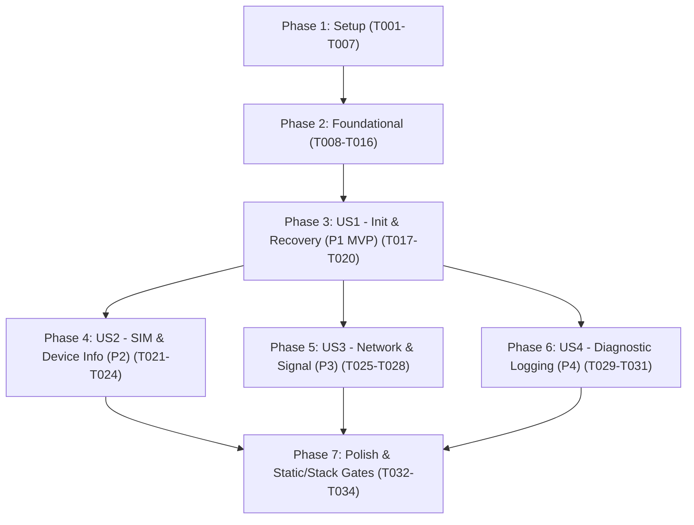

# Tasks: Basic Modem Initialization and Control

**Input**: Design documents from `/specs/001-basic-modem-control/`

**Prerequisites**: [plan.md](plan.md) (required), [spec.md](spec.md) (required for user stories), [research.md](research.md), [data-model.md](data-model.md), [contracts/](contracts/), [quickstart.md](quickstart.md)

**Tests**: Included per Project Constitution Section 4 (100% off-target host unit and chaos/edge-case verification via Unity + Mock HAL is a mandatory gate).

**Organization**: Tasks are grouped by user story (`US1`–`US4`) to enable independent implementation, verification, and incremental delivery.

## Format: `[ID] [P?] [Story] Description`

- **[P]**: Can run in parallel (different files, no dependencies on incomplete tasks)
- **[Story]**: Which user story this task belongs to (`[US1]`, `[US2]`, `[US3]`, `[US4]`)
- Exact repository-relative file paths are included in every task description

---

## Phase 1: Setup (Shared Infrastructure)

**Purpose**: Initialize repository directory layout, CMake C11 build system, Unity test runner, and public C header contracts.

- [X] T001 Create project directory structure (`inc/`, `inc/internal/`, `src/`, `src/profiles/`, `tests/`, `tests/unity/`, `tests/mocks/`, `tests/unit/`) per `specs/001-basic-modem-control/plan.md`
- [X] T002 Create root build configuration with ISO C11 standard (`-std=c11`), strict compiler warning flags (`-Wall -Wextra -Werror -Wpedantic -Wconversion -Wsign-conversion -Wshadow -Wundef -Wcast-qual -fno-common -fstack-usage`), and `libsimcom` static library target in `CMakeLists.txt`
- [X] T003 [P] Add Unity unit test framework (`tests/unity/unity.h`, `tests/unity/unity_internals.h`, `tests/unity/unity.c`) and configure CTest executable targets in `tests/CMakeLists.txt`
- [X] T004 [P] Create compile-time configuration header with static buffer capacities, default timeouts/retries, and C11 `_Static_assert` checks in `inc/simcom_cfg.h` (from `specs/001-basic-modem-control/contracts/simcom_cfg_contract.h`)
- [X] T005 Create public types header defining status/fault/lifecycle enums, `simcom_hal_if_t`, `simcom_log_fn_t`, domain telemetry structs, and `simcom_handle_t` in `inc/simcom_types.h` (from `specs/001-basic-modem-control/contracts/simcom_types_contract.h`)
- [X] T006 [P] Create modem profile abstraction header declaring `simcom_modem_profile_t` and `g_simcom_profile_a76xx` in `inc/simcom_profile.h`
- [X] T007 Create public non-blocking C API header declaring all lifecycle, I/O, identity, SIM, and network functions in `inc/simcom.h` (from `specs/001-basic-modem-control/contracts/simcom_api_contract.h`)

---

## Phase 2: Foundational (Blocking Prerequisites)

**Purpose**: Core lock-free SPSC ring buffer, bounds-checked span parser primitives, dual-path AT lexer, A76XX profile table, base command transaction mechanics, and mock HAL infrastructure that MUST be complete before user stories begin.

**⚠️ CRITICAL**: No user story work can begin until this phase is complete.

- [X] T008 [P] Implement deterministic mock HAL (`uart_tx_async` byte capture and partial-write simulator, controllable monotonic `get_tick_ms` clock, and event/log spy buffers) in `tests/mocks/mock_simcom_hal.h` and `tests/mocks/mock_simcom_hal.c`
- [X] T009 [P] Implement ISR-safe lock-free SPSC RX ring buffer (`simcom_ringbuf_init`, `simcom_ringbuf_push`, `simcom_ringbuf_pop`, `simcom_ringbuf_reset`, and `rx_overflow` flag handling within `<= 32B` stack budget) in `inc/internal/simcom_ringbuf.h` and `src/simcom_ringbuf.c`
- [X] T010 [P] Implement defensive bounds-checked span tokenizers (prefix matcher, comma-delimited token slicer, quoted string extractor, safe `uint32_t`/`int32_t` numeric converters, and `+CME ERROR:` / `+CMS ERROR:` code extractors) in `inc/internal/simcom_parser.h` and `src/simcom_parser.c`
- [X] T011 [P] Implement dual-path AT lexer (`SIMCOM_LEXER_MODE_LINE` and `SIMCOM_LEXER_MODE_RAW_BYTES`, CRLF line accumulator, overflow discard-until-CRLF resynchronization, terminal response classifier, and `.rodata` URC prefix dispatcher) in `inc/internal/simcom_lexer.h` and `src/simcom_lexer.c`
- [X] T012 [P] Implement immutable SIMCom A76XX modem profile descriptor (`g_simcom_profile_a76xx` in `.rodata` with A76XX command strings and per-command timeouts) in `src/profiles/simcom_profile_a76xx.c`
- [X] T013 Implement base non-blocking AT command transaction engine (incremental `uart_tx_async` streaming for partial writes, wrap-around-safe `(now - start) >= timeout_ms` timer checks, and per-command retry counter) in `inc/internal/simcom_fsm.h` and `src/simcom_fsm.c`
- [X] T014 [P] Write unit tests for SPSC ring buffer push/pop, wrap-around, partial writes, and saturation overflow flagging in `tests/unit/test_ringbuf.c`
- [X] T015 [P] Write unit and boundary/malformed-input tests for span tokenizers, safe integer parsing, and `+CME ERROR` extraction in `tests/unit/test_parser.c`
- [X] T016 Write unit and chaos tests for dual-path AT lexer (1-byte fragmented reception per poll, 1024-byte RX overflow line discard and resynchronization, and URC classification) in `tests/unit/test_lexer_urc.c`

**Checkpoint**: Foundation ready — SPSC ring buffer, parser primitives, lexer, A76XX profile, and mock HAL are verified on host.

---

## Phase 3: User Story 1 - Modem Initialization and Operational Setup (Priority: P1) 🎯 MVP

**Goal**: Initialize the SIMCom A76XX modem over the user's non-blocking I/O interface, disable command echo (`ATE0`), verify/set full functionality (`AT+CFUN=1`), configure numeric CME errors and registration URCs, apply runtime timing/retry configuration, and execute the two-tier fault recovery ladder (Tier 1 soft re-sync → Tier 2 logical reset → `SIMCOM_FAULT_MODEM_UNRESPONSIVE`).

**Independent Test**: Initialize a `simcom_handle_t` with `mock_simcom_hal`, call `Simcom_StartInit()`, step `Simcom_Poll()` while feeding canned A76XX responses via `Simcom_FeedBytes()`, and verify transition to `SIMCOM_STATE_READY`; simulate timeouts to verify automatic escalation through Tier 1 and Tier 2 recovery to `SIMCOM_FAULT_MODEM_UNRESPONSIVE`.

### Tests for User Story 1 ⚠️

> **NOTE: Write these tests FIRST, ensure they FAIL before completing User Story 1 implementation**

- [X] T017 [P] [US1] Write unit and fault-injection tests for initialization sequence (`AT` → `ATE0` → `AT+CFUN?`/`AT+CFUN=1` → `AT+CMEE=2` → `AT+CREG=1`/`AT+CGREG=1`/`AT+CEREG=1`), partial TX writes, `Simcom_SetConfig` overrides, and Tier 1 (`AT` re-sync) → Tier 2 (`AT+CRESET` + `RDY` wait) → `SIMCOM_FAULT_MODEM_UNRESPONSIVE` escalation in `tests/unit/test_init_recovery.c`

### Implementation for User Story 1

- [X] T018 [US1] Implement `SIMCOM_STATE_INITIALIZING` workflow step table (`AT` handshake, `ATE0`, `+CFUN:` check and conditional `AT+CFUN=1`, `AT+CMEE=2`, `AT+CREG=1`, `AT+CGREG=1`, `AT+CEREG=1`) and `+CFUN:` response parser in `src/simcom_parser.c` and `src/simcom_fsm.c`
- [X] T019 [US1] Implement two-tier fault recovery FSM states (`SIMCOM_STATE_RECOVERY_TIER1` soft re-synchronization via `tier1_sync_retries` `AT\r\n` probes and `SIMCOM_STATE_RECOVERY_TIER2` logical reset via profile `AT+CRESET` awaiting `RDY` URC up to `tier2_reset_timeout_ms`, transitioning to `SIMCOM_STATE_FAULT` with `SIMCOM_FAULT_MODEM_UNRESPONSIVE` and firing `SIMCOM_EVENT_FAULT`) in `src/simcom_fsm.c` and `src/simcom_lexer.c`
- [X] T020 [US1] Implement public lifecycle and I/O functions (`Simcom_Init`, `Simcom_SetConfig`, `Simcom_StartInit`, `Simcom_Poll`, `Simcom_FeedBytes`, `Simcom_GetState`, `Simcom_GetFault`) in `src/simcom.c`

**Checkpoint**: User Story 1 (MVP) is complete and independently verifiable on host via `ctest -R test_init_recovery`.

---

## Phase 4: User Story 2 - SIM Card Validation and Hardware Identity Retrieval (Priority: P2)

**Goal**: Query and cache physical modem identity (`Manufacturer`, `Model`, `Revision`, `IMEI`), detect SIM card operational state (`READY`, `PIN_REQUIRED`, `PUK_REQUIRED`, `ABSENT`, `FAULTY`), read the 20-digit `ICCID` when ready, and support an explicit single-shot `Simcom_SubmitSimPin()` request that is never retried automatically.

**Independent Test**: From `SIMCOM_STATE_READY`, trigger `Simcom_RequestDeviceInfo()` and `Simcom_RequestSimStatus()` against mocked A76XX responses (`ATI`, `AT+CPIN?`, `AT+CICCID`, `+CME ERROR: 10`), verify cached structs via `Simcom_GetDeviceInfo()` and `Simcom_GetSimInfo()`, and verify `Simcom_SubmitSimPin()` transmits `AT+CPIN="<pin>"` exactly once without retry on error or timeout.

### Tests for User Story 2 ⚠️

- [X] T021 [P] [US2] Write unit tests for hardware identity retrieval (`ATI` / `AT+CGMM` / `AT+CGMR` / `AT+CGSN`), SIM status categorization (`READY`, `SIM PIN`, `SIM PUK`, `SIM CRASH`, `+CME ERROR: 10` absent, `+CME ERROR: 13` faulty), `+ICCID:` extraction, and single-shot `Simcom_SubmitSimPin()` non-retry and `pin_scratch` zeroing in `tests/unit/test_sim_device_info.c`

### Implementation for User Story 2

- [X] T022 [P] [US2] Implement bounds-checked response parsers for `ATI` labeled lines (`Manufacturer:`, `Model:`, `Revision:`, `IMEI:`), standalone `AT+CGMM`/`AT+CGMR`/`AT+CGSN` responses, `+CPIN:` state strings, SIM `+CME ERROR` codes (`10`, `12`, `13`, `15`, `16`), and `+ICCID:` serial extraction in `src/simcom_parser.c`
- [X] T023 [US2] Implement Device Identity workflow (`ATI` followed by conditional `AT+CGMM`/`AT+CGMR`/`AT+CGSN` fallback if any field is empty), SIM Status & conditional `AT+CICCID` workflow, asynchronous `+CPIN:` URC handler, and single-shot PIN submission workflow (`retries_left = 0` and immediate `memset` clearing of `pin_scratch` after TX) in `src/simcom_fsm.c` and `src/simcom_lexer.c`
- [X] T024 [US2] Implement public API entry points `Simcom_RequestDeviceInfo`, `Simcom_GetDeviceInfo`, `Simcom_RequestSimStatus`, `Simcom_SubmitSimPin`, and `Simcom_GetSimInfo` in `src/simcom.c`

**Checkpoint**: User Stories 1 AND 2 are both independently functional and verified via `ctest -R test_sim_device_info`.

---

## Phase 5: User Story 3 - Network Registration and Carrier Status Monitoring (Priority: P3)

**Goal**: Monitor circuit-switched (`+CREG`), packet-switched (`+CGREG`), and EPS/LTE (`+CEREG`) network registration states via both asynchronous URCs and on-demand queries, and retrieve signal quality (`AT+CSQ` RSSI/dBm and BER), operator name and access technology (`AT+COPS?`), and serving cell system mode (`AT+CPSI?`).

**Independent Test**: Inject unsolicited `+CREG:`/`+CGREG:`/`+CEREG:` URCs both while idle and mid-command to verify immediate `SIMCOM_EVENT_NET_REG_URC_CHANGED` callback dispatch and cache updates without command corruption; run `Simcom_RequestNetworkStatus()` and verify `Simcom_GetNetworkStatus()` fields.

### Tests for User Story 3 ⚠️

- [X] T025 [P] [US3] Write unit and mid-command URC injection tests for `+CREG`/`+CGREG`/`+CEREG` URC callbacks and solicited queries, `+CSQ` dBm conversion (`0..31` and `99`), `+COPS?` operator/AcT parsing, and `+CPSI?` system mode parsing in `tests/unit/test_network_status.c`

### Implementation for User Story 3

- [X] T026 [P] [US3] Implement bounds-checked parsers for `+CREG:`, `+CGREG:`, `+CEREG:` (distinguishing `<n>,<stat>` solicited responses from `<stat>` URCs), `+CSQ:` (computing `rssi_dbm = -113 + 2 * rssi_raw` and handling `99`), `+COPS:` (`<oper>` and `<AcT>` mapping to `simcom_act_t`), and `+CPSI:` (`<System Mode>`) in `src/simcom_parser.c`
- [X] T027 [US3] Wire asynchronous `+CREG:`, `+CGREG:`, and `+CEREG:` URC dispatch in `src/simcom_lexer.c` to update `me->net_status` and emit `SIMCOM_EVENT_NET_REG_URC_CHANGED`, and implement the Network Status query workflow (`AT+CREG?` → `AT+CGREG?` → `AT+CEREG?` → `AT+CSQ` → `AT+COPS?` → `AT+CPSI?` using `net_query_timeout_ms`) in `src/simcom_fsm.c`
- [X] T028 [US3] Implement public API entry points `Simcom_RequestNetworkStatus` and `Simcom_GetNetworkStatus` in `src/simcom.c`

**Checkpoint**: User Stories 1, 2, AND 3 are independently functional and verified via `ctest -R test_network_status`.

---

## Phase 6: User Story 4 - Diagnostic Logging and Communication Auditing (Priority: P4)

**Goal**: Dispatch raw TX commands, solicited RX responses, asynchronous URCs, and internal FSM/recovery transitions to a user-provided logging callback with monotonic timestamps and configurable minimum severity filtering (`DEBUG`, `INFO`, `WARNING`, `ERROR`, `NONE`), with zero overhead when disabled.

**Independent Test**: Register a logging callback in `Simcom_Init()`, run command and URC transactions across varying `min_log_level` thresholds, verify exact payload/direction/severity capture and suppression, and verify normal execution when `log_fn == NULL`.

### Tests for User Story 4 ⚠️

- [X] T029 [P] [US4] Write unit tests for diagnostic logging callback across `TX`, `RX`, `URC`, and `FSM` events, runtime `min_log_level` filtering via `Simcom_SetConfig()`, and `NULL` logging callback execution in `tests/unit/test_logging_config.c`

### Implementation for User Story 4

- [X] T030 [P] [US4] Declare and implement severity-filtered diagnostic logging helper (`simcom_log_emit` with $O(1)$ `log_fn == NULL` and `level < me->cfg.min_log_level` short-circuit) in `inc/internal/simcom_log.h` and `src/simcom_log.c`
- [X] T031 [US4] Instrument AT command transmission (`SIMCOM_LOG_DIR_TX`), solicited line reception and RX overflow warnings (`SIMCOM_LOG_DIR_RX`), URC notifications (`SIMCOM_LOG_DIR_URC`), and lifecycle/recovery transitions (`SIMCOM_LOG_DIR_FSM`) in `src/simcom_fsm.c` and `src/simcom_lexer.c`

**Checkpoint**: All four user stories (`US1`–`US4`) are complete and independently verified.

---

## Phase 7: Polish & Cross-Cutting Concerns

**Purpose**: Enforce Constitution Section 3 & 4 stack-budget, static analysis, and quickstart validation gates across the entire library.

- [X] T032 [P] Add stack-usage verification target checking compiler-generated `.su` files (`<= 128 Bytes` per public API function in `src/simcom.c` and `<= 32 Bytes` for `Simcom_FeedBytes`) in `CMakeLists.txt`
- [X] T033 [P] Run `cppcheck --enable=all --std=c11 --error-exitcode=1` and `clang-tidy` across `inc/` and `src/` and resolve any warnings or MISRA C:2012 / BARR-C:2018 compliance issues in `src/*.c`
- [X] T034 Execute full CTest suite and end-to-end validation scenarios documented in `specs/001-basic-modem-control/quickstart.md`

---

## Dependencies & Execution Order

### Phase Dependencies

- **Phase 1 (Setup)**: No dependencies — can start immediately.
- **Phase 2 (Foundational)**: Depends on Phase 1 completion — **BLOCKS** all user stories.
- **Phase 3 (US1 - P1 MVP)**: Depends on Phase 2 completion. Establishes `Simcom_Init`, `Simcom_Poll`, `Simcom_FeedBytes`, initialization workflow, and Tier 1/2 recovery.
- **Phase 4 (US2 - P2)**: Depends on Phase 2 completion (and integrates into `src/simcom_fsm.c` / `src/simcom.c` alongside US1).
- **Phase 5 (US3 - P3)**: Depends on Phase 2 completion (and integrates into `src/simcom_fsm.c` / `src/simcom_lexer.c` / `src/simcom.c`).
- **Phase 6 (US4 - P4)**: Depends on Phase 2 completion (instruments lexer and FSM with `src/simcom_log.c`).
- **Phase 7 (Polish)**: Depends on Phases 3–6 completion.

### User Story Dependency Graph



### Parallel Opportunities

- **Setup (Phase 1)**: `T003` (Unity setup), `T004` (`simcom_cfg.h`), and `T006` (`simcom_profile.h`) can run in parallel after `T001`.
- **Foundational (Phase 2)**: `T008` (Mock HAL), `T009` (SPSC Ring Buffer), `T010` (Span Parser), `T011` (AT Lexer), and `T012` (A76XX Profile) operate on distinct files and can be developed in parallel; unit test suites `T014` and `T015` can also be written in parallel.
- **User Stories (Phases 3–6)**: Within each story, unit test authoring (`T017`, `T021`, `T025`, `T029`) and isolated module tasks (`T022` in `src/simcom_parser.c`, `T026` in `src/simcom_parser.c`, `T030` in `src/simcom_log.c`) can run in parallel before wiring into `src/simcom_fsm.c` and `src/simcom.c`.

---

## Parallel Example: Foundational & User Story Phases

```bash
# Foundational Phase (Phase 2) - Parallel core module implementation:
Task T008: "Implement deterministic mock HAL in tests/mocks/mock_simcom_hal.h and tests/mocks/mock_simcom_hal.c"
Task T009: "Implement ISR-safe lock-free SPSC RX ring buffer in inc/internal/simcom_ringbuf.h and src/simcom_ringbuf.c"
Task T010: "Implement defensive bounds-checked span tokenizers in inc/internal/simcom_parser.h and src/simcom_parser.c"
Task T012: "Implement immutable SIMCom A76XX modem profile descriptor in src/profiles/simcom_profile_a76xx.c"

# User Story 2 (Phase 4) - Parallel test and parser implementation:
Task T021: "Write unit tests for hardware identity and SIM status in tests/unit/test_sim_device_info.c"
Task T022: "Implement bounds-checked response parsers for ATI, +CPIN:, +CME ERROR, and +ICCID: in src/simcom_parser.c"
```

---

## Implementation Strategy

### MVP First (User Story 1 Only)

1. Complete **Phase 1: Setup** (`T001`–`T007`).
2. Complete **Phase 2: Foundational** (`T008`–`T016`) and verify `test_ringbuf`, `test_parser`, and `test_lexer_urc` pass.
3. Complete **Phase 3: User Story 1** (`T017`–`T020`).
4. **STOP and VALIDATE**: Run `ctest -R test_init_recovery` to verify non-blocking handshake, echo suppression, functionality setup, runtime configuration, and Tier 1 → Tier 2 → `MODEM_UNRESPONSIVE` recovery escalation.

### Incremental Delivery

1. **Foundation + US1 (MVP)**: Modem initializes reliably and recovers from soft/logical hangs.
2. **Add US2 (SIM & Identity)**: Device provisions IMEI/ICCID and safely handles missing or PIN-locked SIM cards with single-shot PIN entry.
3. **Add US3 (Network & Signal)**: Application tracks live `+CREG`/`+CGREG`/`+CEREG` URC changes and queries RSSI/dBm, operator name, and LTE/GSM serving cell mode.
4. **Add US4 + Polish (Logging & Gates)**: Full field diagnostic auditing, stack-usage verification (`<= 128B` / `<= 32B`), and zero-warning `cppcheck`/`clang-tidy` sign-off.
